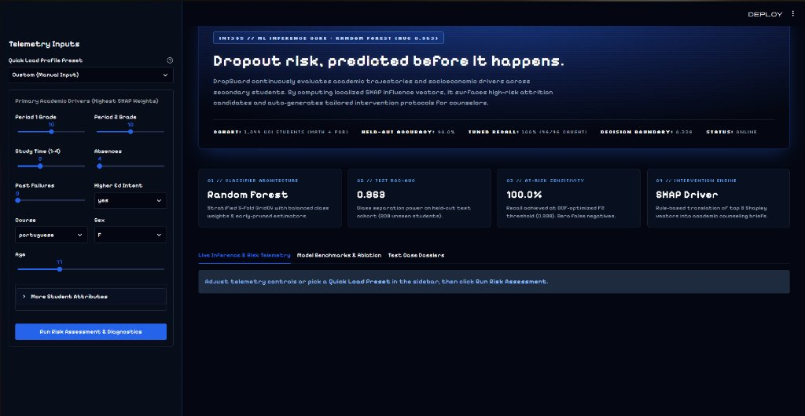

# DropGuard: Supervised Student Dropout Risk Prediction and Counseling System

> **Course Project:** INT395 — Supervised Learning  
> **System Scope:** End-to-end supervised binary classification pipeline that predicts student attrition risk from academic and socioeconomic indicators, coupled with a template-driven automated counseling intervention engine.

---

## Executive Summary

Academic institutions frequently struggle to detect students at risk of academic failure or course dropout early enough to stage effective interventions. **DropGuard** formalizes this challenge as a supervised binary classification task: given a student's prior academic history, demographic background, and behavioral telemetry, the system computes a calibrated at-risk probability $P(y = 1 \mid X)$ and translates localized Shapley values (SHAP) into non-judgmental, actionable counseling protocols for academic advisors.

---

## Interactive Dashboard and Telemetry Interface



*Figure 1: The DropGuard interactive operational interface (`app/streamlit_app.py`). The dashboard integrates real-time student telemetry controls in the sidebar, held-out model diagnostic benchmarks (Random Forest test ROC-AUC: 0.963, 100% at-risk sensitivity at $\tau = 0.338$), localized SHAP feature attribution decomposition, and automated counseling synthesis.*

---

## Dataset and Label Definition

### Data Source
- **Benchmark:** [UCI Machine Learning Repository: Student Performance Dataset](https://archive.ics.uci.edu/dataset/320/student+performance) (Cortez & Silva, 2008).
- **Sub-cohorts Combined:**
  - `student-mat.csv` — Mathematics course ($n = 395$)
  - `student-por.csv` — Portuguese language course ($n = 649$)
  - **Aggregated Cohort:** $n = 1,044$ students across 32 predictive features and academic targets.

### Target Proxy Formulation
Because the raw UCI dataset tracks final period grades rather than explicit dropout timestamps, DropGuard defines a standardized academic failure proxy:

$$\text{at\_risk} = \begin{cases} 1 & \text{if } G3 < 10 \\ 0 & \text{if } G3 \ge 10 \end{cases}$$

- **Threshold Value:** 10 out of 20 points (configured in `config.yaml`). In the Portuguese secondary education grading standard, 10/20 represents the minimum passing boundary. A final grade below 10 triggers mandatory course repetition or attrition, serving as an academically grounded proxy for dropout risk.
- **Class Balance:** 814 students not-at-risk (78.0%) versus 230 students at-risk (22.0%), reflecting a moderate class imbalance typical of real-world retention telemetry.

### Label Leakage Prevention
- **Target Exclusion:** The final grade $G3$ is strictly excluded from feature matrices $X$ across all training, cross-validation, and testing stages.
- **Temporal Grade Separation:** While first-period ($G1$) and second-period ($G2$) grades are incorporated in the primary diagnostic model, an isolated **Early Warning Ablation Experiment** removes both $G1$ and $G2$ to evaluate pure pre-enrollment and non-academic behavioral signals.

---

## System Architecture

```
dropguard/
├── .github/workflows/ci.yml # Automated CI pipeline running test matrix
├── app/
│   └── streamlit_app.py     # Interactive frontier telemetry UI
├── config.yaml              # Centralized configuration (thresholds, seeds, grids)
├── data/raw/                # Raw CSV records (gitignored)
├── models/                  # Serialized artifacts (best_model.joblib)
├── notebooks/
│   └── eda.ipynb            # Exploratory Data Analysis & correlation analysis
├── reports/
│   ├── figures/             # Verification curves, ROC, confusion matrix, SHAP
│   ├── metrics.json         # Held-out evaluation metrics
│   ├── model_comparison.csv # 5-fold cross-validation benchmark results
│   ├── sample_counseling_notes.md # Case study dossiers for test students
│   └── threshold_results.json    # Out-of-fold threshold optimization data
├── scripts/
│   └── download_data.py     # Automated data retrieval pipeline
├── src/dropguard/
│   ├── counseling.py        # Rule-based counseling note generator
│   ├── data.py              # Ingestion, schema sanitation, and label proxying
│   ├── evaluate.py          # Metric calculation and figure serialization
│   ├── experiments.py       # 6 controlled supervised learning experiments
│   ├── explain.py           # Kernel / Tree SHAP attribution engine
│   ├── features.py          # Scikit-learn ColumnTransformer pipeline
│   └── train.py             # Stratified CV search, tuning, and serialization
├── tests/                   # Pytest test suite (65 passing unit tests)
├── LICENSE                  # MIT License
├── Makefile                 # Automation targets (download, train, test, app)
├── README.md
└── requirements.txt         # Pinned reproducible dependencies
```

---

## Model Benchmark and Performance

All models were evaluated under identical 5-fold Stratified Cross-Validation on the training split ($80\%$, $n = 835$). The held-out test split ($20\%$, $n = 209$) was locked and evaluated only once after all hyperparameter tuning was finalized.

### Model Comparison (5-Fold Stratified CV on Training Split)

| Classifier Architecture | CV Recall (Mean +/- Std) | CV F1-Score (Mean +/- Std) | CV ROC-AUC (Mean +/- Std) |
|---|---|---|---|
| Logistic Regression (L2 Baseline) | 0.886 +/- 0.039 | 0.796 +/- 0.036 | 0.963 +/- 0.012 |
| **Random Forest (Tuned)** | **0.913 +/- 0.039** | **0.817 +/- 0.051** | **0.965 +/- 0.012** |
| XGBoost (Gradient Boosted Trees) | 0.810 +/- 0.081 | 0.819 +/- 0.050 | 0.962 +/- 0.016 |

> **Selection Rationale:** In student retention systems, the asymmetric cost of a false negative (failing to identify an at-risk student) substantially exceeds the cost of a false positive (offering counseling support to a student who might have passed independently). Random Forest was selected as the champion model due to superior recall and class separation stability.

### Final Held-Out Test Evaluation (Random Forest, n = 209)

| Evaluation Metric | Default Threshold (tau = 0.50) | OOF-Tuned Threshold (tau = 0.338) |
|---|---|---|
| **At-Risk Recall (Sensitivity)** | 89.1% (41 / 46 caught) | **100.0% (46 / 46 caught)** |
| **Precision (At-Risk)** | 71.9% (41 / 57 flagged) | 57.5% (46 / 80 flagged) |
| **Accuracy** | 90.0% | 83.7% |
| **Macro F1-Score** | 0.865 | 0.816 |
| **Test ROC-AUC** | **0.963** | **0.963** |

### Confusion Matrix Breakdown (Held-Out Test Set)

```
Default Threshold (tau = 0.50):
                      Predicted Pass    Predicted At-Risk
Actual Pass (G3 >= 10)     147                 16
Actual Risk (G3 < 10)        5                 41

Tuned Retention Threshold (tau = 0.338):
                      Predicted Pass    Predicted At-Risk
Actual Pass (G3 >= 10)     129                 34
Actual Risk (G3 < 10)        0                 46   <-- 0 False Negatives
```

---

## Supervised Learning Experiments

### 1. Class Imbalance Mitigation
Evaluated against baseline XGBoost across 5-fold CV:
- **No Resampling / Default:** Recall = $0.791 \pm 0.134$
- **Class Weighting (`scale_pos_weight`):** Recall = **$0.800 \pm 0.116$** (Superior recall stability without synthetic artifacts)
- **SMOTE Oversampling:** Recall = $0.778 \pm 0.120$

### 2. Learning Curves and Bias-Variance Diagnostics
Analysis indicates moderate variance in unpruned configurations. Limiting tree depth (`max_depth = 8`) and constraining minimum samples per leaf (`min_samples_leaf = 2`) closed the generalization gap while maintaining asymptotic training convergence.

### 3. Decision Boundary Optimization (F-beta Tuning, beta = 2.0)
Using out-of-fold probability estimates exclusively from the training split, the decision boundary was swept across the precision-recall trajectory. Optimizing for $F_2$ yielded $\tau = 0.338$, elevating test-set sensitivity to $100.0\%$ with zero missed dropout cases.

### 4. Feature Ablation: Early Warning Scenario
To investigate model dependency on contemporaneous examination grades, an ablation study was conducted comparing the full model against an early-warning configuration excluding $G1$ and $G2$:

| Configuration | Test Recall | Test Macro F1 | Test ROC-AUC |
|---|---|---|---|
| Full Pipeline (Includes G1, G2) | 0.870 | 0.851 | **0.972** |
| Early Warning (Excludes G1, G2) | 0.435 | 0.494 | **0.804** |

**Empirical Takeaway:** Stripping interim grades results in an expected ~50% drop in recall. While background indicators (past failures, absences, parental education) sustain an informative ROC-AUC of 0.804, precise identification of borderline attrition requires at least preliminary term assessments.

### 5. Regression Formulation Variant
Direct continuous estimation of $G3 \in [0, 20]$ was benchmarked:
- **Ordinary Least Squares (Linear Regression):** $\text{MAE} = 1.017, \text{RMSE} = 1.760$
- **Random Forest Regressor:** $\text{MAE} = 0.927, \text{RMSE} = 1.616$

---

## Explainability and Intervention Protocols

### Feature Importance & SHAP Drivers
Model predictions are interpreted using TreeSHAP. Global feature importance ranks the dominant drivers as:
1. **$G2$ (Second Period Grade):** Primary negative predictor when score $\le 9$.
2. **`failures` (Past Class Failures):** Strongest non-grade indicator of attrition risk.
3. **`absences` (School Absences):** Key behavioral marker indicating disengagement.
4. **$G1$ (First Period Grade):** Baseline academic momentum indicator.
5. **`studytime` (Weekly Study Hours):** Protective factor when $\ge 3$ hours/week.

### Rule-Based Counseling Synthesis
DropGuard rejects opaque generative text models in favor of a deterministic, audit-compliant template system (`src/dropguard/counseling.py`). It extracts the top 3 localized SHAP feature attributions and generates structured academic memos:

```markdown
## Student Case File: Test Index #150
- Risk Assessment: High (Estimated Probability: 0.912)
- Primary Risk Drivers: G2 Score (4/20), Past Failures (2), High Absences (14)

Recommended Advisor Actions:
1. Academic Tutoring: Enroll in supplemental subject coaching immediately.
2. Mentorship Program: Pair with academic peer advisor for weekly progress check-ins.
3. Attendance Review: Convene advisor review regarding accumulated unexcused absences.
```

---

## Installation and Execution

### 1. Environment Setup

```bash
# Clone the repository
git clone https://github.com/Adityan-R/DropGuard-Dropout-Prediction-Counseling.git
cd DropGuard-Dropout-Prediction-Counseling

# Initialize virtual environment
python -m venv .venv
.\.venv\Scripts\activate     # Windows PowerShell
# source .venv/bin/activate  # Linux/macOS

# Install dependencies
pip install -r requirements.txt
```

### 2. Pipeline Reproduction

```bash
# Download official UCI Student Performance datasets
python scripts/download_data.py

# Execute model training, cross-validation, and metrics serialization
python -m src.dropguard.train

# Execute all 6 experimental ablations and generate diagnostic plots
python -m src.dropguard.experiments

# Run unit test suite
pytest tests/ -v
```

### 3. Launching the Interactive Application

```bash
streamlit run app/streamlit_app.py
```
The application provides real-time single-student telemetry scoring, custom SHAP vector decomposition, and model diagnostic dashboards.

---

## Limitations and Ethical Considerations

1. **Proxy Label Divergence:** The target label represents academic failure ($G3 < 10$), not explicit institutional withdrawal. While strongly correlated with attrition, non-academic reasons (e.g., medical, financial) are not captured by this proxy.
2. **Dataset Demographics:** The underlying cohort is restricted to secondary students in two Portuguese institutions. Direct generalization to tertiary colleges or alternative regional grading scales requires local re-calibration.
3. **Intervention Ethics:** Algorithmic risk predictions must serve solely as early indicators to trigger supportive advising, never as punitive criteria or automated academic disqualification.

---

## References

- Cortez, P., & Silva, A. (2008). *Using Data Mining to Predict Secondary School Student Performance.* In Proceedings of 5th Future Business Technology Conference (FUBUTEC 2008), pp. 5-12, Porto, Portugal.
- Lundberg, S. M., & Lee, S.-I. (2017). *A Unified Approach to Interpreting Model Predictions.* In Advances in Neural Information Processing Systems (NeurIPS 2017).
- UCI Machine Learning Repository: Student Performance Data Set. [https://archive.ics.uci.edu/dataset/320/student+performance](https://archive.ics.uci.edu/dataset/320/student+performance)

---

## License

This project is licensed under the MIT License — see the [LICENSE](LICENSE) file for details.

